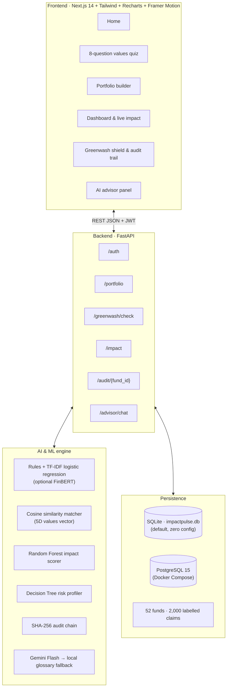

# 🌱 ImpactPulse
### *Verified impact investing for the next generation of investors*
**Submission for: HSBC Challenge · TCS Sustainathon UK&I 2026**

---

<p align="center">
  
</p>

> **"Every investment is a vote for the future of our planet. ImpactPulse makes that vote transparent, verifiable, and personal."**

---

## 📑 Table of Contents
1. [Executive Summary & Challenge Directive](#-executive-summary--challenge-directive)
2. [Market Opportunity](#-market-opportunity)
3. [The Problem: The NextGen ESG Paradox](#-the-problem-the-nextgen-esg-paradox)
4. [The Solution: The 5 Pillars of ImpactPulse](#-the-solution-the-5-pillars-of-impactpulse)
5. [Product Tour](#-product-tour)
6. [System Architecture](#-system-architecture)
7. [AI, Machine Learning & Algorithms](#-ai-machine-learning--algorithms)
8. [Data, Provenance & Governance](#-data-provenance--governance)
9. [Jupyter Notebooks for Evaluators](#-jupyter-notebooks-for-evaluators)
10. [REST API Reference](#-rest-api-reference)
11. [Quickstart](#-quickstart)
12. [Project Structure](#-project-structure)
13. [Frontend Design System](#-frontend-design-system)
14. [Regulatory Fit & UN SDG Alignment](#-regulatory-fit--un-sdg-alignment)
15. [Current Limitations & Roadmap](#-current-limitations--roadmap)
16. [Pitch Deck](#-pitch-deck)
17. [Team & Credits](#-team--credits)

---

## 🏛️ Executive Summary & Challenge Directive

### The HSBC Leadership Directive
Retail and premier banking are shifting toward purpose-driven finance. As framed by **Dominique Khazar** (*Global Financial Well-being Lead & Sustainability Innovative Solution Coordinator for International Wealth and Premier Banking, HSBC*), how capital is deployed is one of the most powerful levers for climate resilience.

### The Core Problem Statement
> **"How might HSBC mobilize NextGen retail wealth into transparent, verified impact investments that fund planetary solutions while dismantling greenwashing skepticism and financial friction?"**

### The ImpactPulse Response
**ImpactPulse** is a working full-stack prototype (Next.js + FastAPI + scikit-learn) built for Gen Z and Millennial retail investors. It connects an investor's values to verified sustainable funds through:

- **Greenwash Shield**: a hybrid rule engine plus a TF-IDF / logistic-regression classifier that labels any fund claim as `verified`, `misleading`, or `false`, with an optional FinBERT fine-tuning path.
- **Values-Vector Personalization**: an 8-question quiz that becomes a 5-dimensional values vector, matched to funds by cosine similarity.
- **HSBC Next Best Action (NBA)**: a concrete monthly micro-allocation suggestion that stays within the investor's suitability band.
- **Physical Impact Quantification**: impact shown in real units (kg CO₂e, kWh, litres of water, m² of forest) instead of ESG letter grades.
- **Tamper-Evident Audit Ledger**: a SHA-256 hash chain in which every claim and every check is linked to the one before it.
- **FCA Consumer Duty Suitability Engine**: a transparent decision tree that keeps first-time investors out of funds that are too volatile for them.
- **Green-AI by design**: small CPU-only scikit-learn models with no GPU in the request path.

---

## 📈 Market Opportunity

```
┌─────────────────────────────────────────────────────────────────────────────┐
│                       THE $68 TRILLION CAPITAL SHIFT                        │
├──────────────────────────────────────┬──────────────────────────────────────┤
│ 84% of Gen Z & Millennial Investors  │ 72% Distrust ESG Claims              │
│ Want their investments to reflect    │ State corporate greenwashing is the  │
│ planetary & societal values.         │ primary barrier stopping allocation. │
├──────────────────────────────────────┼──────────────────────────────────────┤
│ $68 Trillion Wealth Transfer         │ £4.2 Billion Annual Inflow Gap       │
│ Inherited by NextGen over 20 years,  │ Lost to legacy banking due to jargon │
│ the largest wealth shift in history. │ and lack of verifiable impact proof. │
└──────────────────────────────────────┴──────────────────────────────────────┘
```

NextGen investors do not treat wealth as an end in itself. Following frameworks such as John Coleman's *Good Money*, they judge capital by its intent:
1. **Rethink Capital**: money as a catalyst for systemic transition.
2. **Spend & Invest with Intention**: no tolerance for conflict minerals, exploitative labour, or fossil lock-in.
3. **Demand Verifiability**: no marketing promises without auditable, ground-truth metrics.

---

## 🛑 The Problem: The NextGen ESG Paradox

| Bottleneck | Real-World Manifestation | Impact on NextGen Adoption |
|---|---|---|
| **1. Greenwashing** | Funds promise to *"reforest an unspecified area of the Amazon"* or advertise *"eco-friendly leadership"* with no published audit method. | **Distrust:** first-time investors walk away from sustainable funds. |
| **2. Jargon Fog** | Factsheets full of acronyms (SFDR Article 8/9, AUM, tracking error, Scope 3). | **Exclusion:** young retail investors feel locked out. |
| **3. Invisible Impact** | ESG ratings such as "AA" are relative industry scores. They never show what £1,000 actually achieves. | **Disengagement:** without tangible outcomes, impact investing feels like marketing. |

---

## 💡 The Solution: The 5 Pillars of ImpactPulse

```
                         ┌──────────────────────────────┐
                         │      IMPACTPULSE PLATFORM    │
                         └──────────────┬───────────────┘
                                        │
       ┌──────────────┬─────────────────┼─────────────────┬──────────────┐
       ▼              ▼                 ▼                 ▼              ▼
┌─────────────┐ ┌─────────────┐ ┌──────────────┐ ┌──────────────┐ ┌─────────────┐
│  PILLAR 1   │ │  PILLAR 2   │ │   PILLAR 3   │ │   PILLAR 4   │ │  PILLAR 5   │
│  Greenwash  │ │Values-Vector│ │   Physical   │ │ Tamper-proof │ │  Plain-talk │
│   Shield    │ │   Matcher   │ │    Impact    │ │ Audit Chain  │ │  AI Advisor │
└─────────────┘ └─────────────┘ └──────────────┘ └──────────────┘ └─────────────┘
```

1. **Greenwash Shield**: checks any fund claim. It flags vague wording and impossible promises, and rewards named third-party auditors (DNV, SBTi, KPMG, IUCN) and measured numbers.
2. **Values-Vector Matcher**: turns 8 quick questions into coordinates across Climate, Water, Energy, Social, and Governance, then ranks the fund book against them.
3. **Physical Impact**: gauges for carbon, clean energy, water, and forest, plus a "today so far" figure that spreads the annual estimate across the current day.
4. **Audit Chain**: every claim and every shield check is a SHA-256 linked row. Editing an old row breaks every hash after it, and the UI shows "Chain broken".
5. **AI Advisor**: a chat panel that explains finance terms in plain English. It uses Google Gemini when an API key is set and falls back to a built-in glossary of 27 terms when it isn't.

---

## 🖥️ Product Tour

| Route | Screen | What the user does |
|---|---|---|
| `/` | **Home** | Reads the problem, sees a per-£1,000 impact example, and starts the quiz or tests a claim. |
| `/onboarding` | **Values quiz** | Answers 8 questions: five 1–5 value scales plus horizon, drawdown reaction, and monthly savings. Keys **1–5** answer instantly. |
| `/portfolio` | **Portfolio builder** | Sees ranked verified funds with values-match %, SDG tags, the Next Best Action, an allocation donut, and the funds the shield **kept out**. Changes the £ amount and locks the portfolio. |
| `/dashboard` | **Dashboard** | Impact gauges, allocation legend, goal milestones, and a community carbon leaderboard. |
| `/impact` | **Live impact** | Yearly totals, today-so-far figures, SDG weights, and a per-holding breakdown. |
| `/verify` | **Greenwash shield** | Pastes or picks a sample claim and gets a colour-coded verdict with confidence. Attaching a fund shows its full hash-linked audit trail. |
| `/learn` | **Literacy hub** | Eight plain-English cards (ESG, green bond, Scope 3, MRV, …). Tapping one asks the advisor. |

**Demo account:** `alex@impactpulse.app` / `demo1234` (created automatically on first start). Every screen also works without signing in.

<table>
  <tr>
    <td width="50%"><br/><sub>Values quiz: 1–5 scale with keyboard shortcuts</sub></td>
    <td width="50%"><br/><sub>Greenwash shield: verdict and hash-linked audit trail</sub></td>
  </tr>
  <tr>
    <td colspan="2"><br/><sub>Dashboard: impact gauges, allocation, milestones and community leaderboard</sub></td>
  </tr>
</table>

<p align="center">
  
  &nbsp;&nbsp;
  
  <br/><sub>Mobile: menu and portfolio builder with sticky "Lock this portfolio" bar</sub>
</p>

---

## 🏗️ System Architecture



On first start the backend creates the tables, loads the 52 funds, seeds the audit chain and the demo user, and **trains any missing models** (`services/bootstrap.py`).

---

## 🧮 AI, Machine Learning & Algorithms

### 1. Values Vector & Cosine Alignment
The quiz produces a 5-dimensional values vector $\mathbf{u}$:
$$\mathbf{u} = [u_{\text{climate}}, u_{\text{water}}, u_{\text{energy}}, u_{\text{social}}, u_{\text{governance}}] \quad u_i \in [1, 5]$$

Each fund $j$ carries a vector $\mathbf{v}_j$ on the same axes. Alignment is the cosine of the angle between them:
$$\text{Similarity}(\mathbf{u}, \mathbf{v}_j) = \frac{\mathbf{u} \cdot \mathbf{v}_j}{\|\mathbf{u}\| \|\mathbf{v}_j\|}$$

Funds that pass the greenwash and risk filters are ranked by similarity. The top funds get quadratic weights, which reward strong matches without piling everything into one fund:
$$w_j = \frac{(\text{Similarity}_j)^2}{\sum_{m \in \text{Top}} (\text{Similarity}_m)^2}$$

### 2. Physical Impact Score (MCDA + Random Forest)
Each fund's metrics are given per £1,000 invested for one year and combined into a multi-criteria score:
$$\text{Impact Score} = \min\left(99, \left\lfloor 40 \cdot \min\left(\tfrac{\text{CO}_2}{50}, 1.2\right) + 30 \cdot \min\left(\tfrac{\text{kWh}}{220}, 1.2\right) + 15 \cdot \min\left(\tfrac{\text{Water}}{2000}, 1.2\right) + 10 \cdot \min\left(\tfrac{\text{Forest}}{1.2}, 1.2\right) + 5 \cdot \tfrac{\text{Gov}}{5} \right\rfloor\right)$$

- A **Random Forest Regressor** ($n_{\text{estimators}} = 200$) learns this score from the fund features, including $\ln(\text{AUM})$, expense ratio, and risk tier. Its output is shown alongside the formula score as the "model score".
- **Today so far** scales the annual figure for a portfolio of size $A$ by the fraction of the current day that has passed:
$$\text{CO}_2^{\text{today}} = \left(\tfrac{A}{1000} \cdot \text{CO}_{2,\text{annual}}\right) \cdot \frac{1}{365} \cdot \frac{t_{\text{since midnight}}}{24\,\text{h}}$$

### 3. Risk Profiling (FCA Consumer Duty)
A **Decision Tree Classifier** (max depth 8) is trained on the transparent rule below, and the rule itself stays in the code as a fallback:

$$\text{Profile} = \begin{cases}
\text{Conservative}, & r = \text{sell} \lor h \le 2 \lor (a \ge 45 \land r \ne \text{buy}) \\
\text{Growth}, & (r = \text{buy} \land h \ge 7) \lor (h \ge 8 \land s \ge 200) \\
\text{Balanced}, & \text{otherwise}
\end{cases}$$

where $a$ is age, $h$ is horizon in years, $s$ is monthly savings in £, and $r$ is the reaction to a 20% drop. A Conservative investor sees only Conservative funds, a Balanced investor sees Conservative and Balanced, and a Growth investor sees all three.

### 4. Hybrid Greenwash Detector
1. **Rule layer** with high-confidence patterns:
   - absolute or impossible claims (*"guaranteed carbon negative"*, *"eliminates all emissions overnight"*) → `false`
   - vague qualifiers with no numbers (*"aims to"*, *"unspecified area"*, *"various projects"*) → `misleading`
   - named auditors and measurement words (`DNV`, `KPMG`, `SBTi-validated`, `metered`) → `verified`
2. **ML layer**: a TF-IDF vectorizer (word 1–2-grams, up to 6,000 features) with class-balanced **logistic regression**, trained on 2,000 labelled claims. This is the default engine (`tfidf-logreg`).
3. **Optional transformer**: `python ml/train_greenwash.py --finbert` fine-tunes `ProsusAI/finbert`. If those weights exist, the detector uses them automatically. This path needs `torch` and `transformers`, which are not in `requirements.txt`.

High-confidence rule hits take priority, and the ML label decides everything else. Every response reports which engine produced it.

### 5. Audit Chain (SHA-256)
$$\text{Hash}_n = \text{SHA256}(\text{Fund ID} \parallel \text{Claim} \parallel \text{Source} \parallel \text{Timestamp} \parallel \text{Hash}_{n-1})$$
Changing any earlier claim changes every hash after it. `GET /audit/{fund_id}` recomputes the chain and returns `intact: true/false`, which the UI shows as **Chain intact** or **Chain broken**. Each shield check that is attached to a fund is appended as a new row.

### 6. AI Advisor
`POST /advisor/chat` uses Google Gemini (`gemini-1.5-flash`, then `gemini-2.0-flash`) with a system prompt that forbids invented figures. Without `GEMINI_API_KEY`, or if the call fails, it answers from a local glossary of 27 terms, so the demo works offline.

---

## 📊 Data, Provenance & Governance

### Data files (`data/`)
| File | Contents |
|---|---|
| `funds_dataset.csv` | 52 curated sustainable funds across categories such as renewable energy, water, forests, oceans, clean transport, circular economy, and social inclusion. Each row has values-axis scores, risk tier, fees, AUM, per-£1,000 impact metrics, SDGs, a marketing claim, its source, and a label. |
| `greenwash_training_data.csv` | 2,000 labelled claims (`verified` / `misleading` / `false`). |
| `impact_metrics_seed.json` | Baseline metrics per £1,000 invested. |
| `sdg_mapping.json` | Fund-to-SDG mapping. |

`backend/ml/build_datasets.py` regenerates these files.

### Provenance
The fund metrics are illustrative values calibrated against the kinds of benchmarks published in sustainability assurance work:
- **Offshore wind:** DNV-style capacity-factor and MWh attribution
- **Emissions pathways:** Science Based Targets initiative (SBTi) sector pathways
- **Green and municipal bonds:** KPMG / ISS ESG second-party opinions
- **Peatland and forestry:** IUCN UK Peatland Code sequestration tables

> ⚠️ The fund book is a **demonstration dataset**. Fund names and figures are illustrative and are not live market data or investment advice.

---

## 📓 Jupyter Notebooks for Evaluators

All four notebooks in `notebooks/` are saved with their outputs, so you can read them without running anything.

| Notebook | Focus | Highlights |
|---|---|---|
| [`01_greenwash_detection_demo.ipynb`](notebooks/01_greenwash_detection_demo.ipynb) | Claim verification | Dataset exploration, confusion matrix, classification report, class probabilities, live hash-chain build |
| [`02_portfolio_recommendation_demo.ipynb`](notebooks/02_portfolio_recommendation_demo.ipynb) | Values matching | Cosine alignment, match comparison chart, greenwash exclusion log, allocation donut |
| [`03_impact_score_analysis.ipynb`](notebooks/03_impact_score_analysis.ipynb) | Physical impact | Carbon and energy intensities, Random Forest feature importance, £2,500 scaling example |
| [`04_risk_profiling_demo.ipynb`](notebooks/04_risk_profiling_demo.ipynb) | Suitability | Risk boundary plot and four investor personas (student, tech worker, retail, senior) |

---

## 🔌 REST API Reference

Interactive Swagger docs: **`http://localhost:8000/docs`**

| Method | Endpoint | Purpose |
|---|---|---|
| `GET` | `/health` | Health check |
| `GET` | `/funds` | Full fund book |
| `POST` | `/auth/register` · `/auth/login` | Create an account or sign in (returns a JWT) |
| `POST` | `/portfolio/recommend` | Values + risk → ranked verified funds, allocations, Next Best Action, kept-out funds |
| `POST` | `/portfolio/save` | Lock a portfolio |
| `GET` | `/portfolio/{user_id}` | A user's latest portfolio with impact |
| `GET` | `/impact/{portfolio_id}` | Yearly totals, per-day rates, SDG weights, per-holding breakdown |
| `GET` | `/impact/leaderboard` | Community carbon leaderboard |
| `POST` | `/greenwash/check` | Classify a claim; appends to the audit chain when `fund_id` is given |
| `GET` | `/audit/{fund_id}` | A fund's audit events plus chain integrity |
| `POST` | `/advisor/chat` | Plain-English answer from Gemini or the local glossary |

<details>
<summary><strong>Example requests</strong></summary>

`POST /portfolio/recommend`
```json
{
  "values": { "climate": 5, "water": 3, "energy": 5, "social": 2, "governance": 4 },
  "age": 22,
  "horizon_years": 8,
  "monthly_savings": 150,
  "drop_reaction": "buy",
  "amount_gbp": 1000,
  "name": "Alex"
}
```

`POST /greenwash/check`
```json
{ "text": "This fund aims to reforest an unspecified area of the Amazon.", "fund_id": 2 }
```
Response:
```json
{ "label": "misleading", "confidence": 0.9, "reason": "…", "probabilities": { … }, "model": "tfidf-logreg" }
```

`POST /advisor/chat`
```json
{ "message": "What is the difference between Scope 1 and Scope 3 emissions?" }
```
</details>

---

## 🚀 Quickstart

### Prerequisites
- Python 3.11+
- Node.js 18+
- Docker and Docker Compose (only for Option 2)

### Option 1: Local (SQLite, zero config)

**1. Backend**
```bash
cd backend
python -m venv venv
venv\Scripts\activate        # Windows
# source venv/bin/activate   # macOS / Linux

pip install -r requirements.txt
uvicorn main:app --reload --port 8000
```
The first start creates `backend/impactpulse.db`, seeds the 52 funds, the audit chain, and the demo user, and trains the models (`*.joblib` files are not committed). Expect it to take a little longer than later starts.

**2. Frontend** (in a second terminal)
```bash
cd frontend
npm install
npm run dev
```
Open **http://localhost:3000**.

**3. Optional: Gemini advisor**
```bash
cp .env.example .env    # in the repository root
# set GEMINI_API_KEY=... in .env
```
Without a key, the advisor uses the built-in glossary.

### Option 2: Docker Compose (PostgreSQL + FastAPI + Next.js)
```bash
cp .env.example .env    # optionally add GEMINI_API_KEY
docker-compose up --build
```
- Frontend: http://localhost:3000
- API: http://localhost:8000 · Docs: http://localhost:8000/docs

### Environment variables
| Variable | Default | Purpose |
|---|---|---|
| `GEMINI_API_KEY` | *(empty)* | Turns on the Gemini advisor |
| `JWT_SECRET` | `change-me-impactpulse-demo` | Token signing; **change it for any shared deployment** |
| `DATABASE_URL` | SQLite file | PostgreSQL URL (Compose sets this itself) |
| `NEXT_PUBLIC_API_URL` | `http://localhost:8000` | API address used by the frontend |

---

## 🗂️ Project Structure

```
ImpactPulse/
├── backend/
│   ├── main.py                 # FastAPI app, router wiring, /funds, /health
│   ├── routers/                # auth, portfolio, impact, greenwash, audit, advisor
│   ├── services/               # recommendation_engine, risk_profiler, impact_scorer,
│   │                           # greenwash_detector, audit_chain, jargon_simplifier, bootstrap
│   ├── ml/                     # build_datasets.py, train_greenwash.py, train_impact_scorer.py
│   ├── models.py · schemas.py · database.py
│   └── requirements.txt
├── frontend/
│   ├── app/                    # routes: /, onboarding, portfolio, dashboard, impact, verify, learn
│   ├── components/             # NavBar, ImpactGauge, PortfolioDonut, GreenwashBadge,
│   │                           # AuditTimeline, GoalMilestone, ImpactLeaderboard, AIAdvisorChat
│   └── lib/api.ts              # typed API client + local session storage
├── data/                       # fund book, training claims, SDG mapping
├── database/                   # schema.sql, seed.sql (PostgreSQL)
├── notebooks/                  # four evaluator notebooks with outputs
├── docs/                       # architecture.svg, user_journey.svg, screenshots/, pitch guide
└── docker-compose.yml
```

---

## 🎨 Frontend Design System

The UI uses a warm "paper and ink" look, chosen to feel calm and trustworthy rather than like a trading app.

| Token | Value | Use |
|---|---|---|
| `paper` | `#efe7d8` | Page background |
| `ink` | `#14241c` | Text and primary buttons |
| `leaf` | `#1c7a4a` | Verified, progress, CO₂ |
| `lime` | `#e2f26b` | Highlights and secondary actions |
| `sea` | `#1d6a72` | Labels, energy, water |
| `amber` / `clay` | `#c9841a` / `#c4543a` | Misleading / false |

- **Type:** Fraunces for headings, Outfit for body text, IBM Plex Mono for tickers and hashes. Numbers use tabular figures.
- **Responsive:** a dedicated mobile menu, 2×2 gauges on phones, and a sticky "Lock this portfolio" bar on mobile.
- **Accessible:** visible keyboard focus rings, labelled form fields, ARIA progress bars and live regions, a keyboard-answerable quiz, and support for `prefers-reduced-motion`.
- **Honest states:** loading skeletons, empty states with a next step, and error messages that say how to recover.

Tokens live in [`frontend/tailwind.config.js`](frontend/tailwind.config.js). Shared component classes (`.card`, `.btn`, `.kicker`, `.stamp`) are in `@layer components` in [`frontend/app/globals.css`](frontend/app/globals.css).

---

## ⚖️ Regulatory Fit & UN SDG Alignment

### How the design maps to regulation
| Regulation | Requirement | How ImpactPulse addresses it |
|---|---|---|
| **UK FCA Anti-Greenwashing Rule (2024)** | Sustainability claims must be clear, fair, not misleading, and backed by evidence. | The shield flags claims with no numbers or auditor, keeps `misleading` and `false` funds out of recommendations, and shows the user what was excluded. |
| **UK FCA Consumer Duty (Principle 12)** | Good outcomes for retail customers; avoid foreseeable harm. | The suitability tree limits each investor to an appropriate risk band before any fund is shown. |
| **EU SFDR (Articles 8 & 9)** | Transparency on sustainability characteristics and adverse impacts. | Impact is shown as physical outcomes (CO₂e, kWh, water, land) per holding rather than as a single rating. |

*This prototype shows the design approach; it is not a compliance certification.*

### UN Sustainable Development Goals
- **SDG 7 – Clean Energy:** clean kWh financed per portfolio
- **SDG 10 – Reduced Inequalities:** the literacy hub and plain-English advisor lower the barrier to entry
- **SDG 13 – Climate Action:** kg CO₂e avoided or sequestered
- **SDG 14 – Life Below Water:** water and ocean funds tracked in litres
- **SDG 15 – Life on Land:** forest and peatland restoration in m²

---

## 🧭 Current Limitations & Roadmap

**Prototype limits (stated so evaluators know what is real)**
- Fund data is a curated demo set, not a live market feed.
- Impact figures are modelled from per-£1,000 fund metrics; they are not sensor readings.
- The default classifier is TF-IDF + logistic regression. FinBERT is an optional, heavier path.
- The "0.0018 g CO₂e compute" figure in the portfolio view is a design estimate for the lightweight CPU models, not a measured value.
- Auth is demo-grade JWT. A production deployment needs a secret manager, rate limiting, and HSBC identity integration.

**Roadmap**
1. **CDP Open Data** connector for verified corporate climate, water, and forest disclosures.
2. **EU SFDR / ESMA** ingestion of Article 8 and 9 Principal Adverse Impact indicators.
3. **Satellite verification** (e.g. Sentinel-2) for land and reforestation claims.
4. FinBERT as the default shield model, with measured per-query compute emissions.
5. Integration with HSBC accounts for real recurring micro-allocations.

---

## 🎤 Pitch Deck

A 14-slide guide with copy-paste AI prompts (Gamma, Beautiful.ai, Claude/ChatGPT) is in [**`docs/PITCH_DECK_GUIDE_AND_PROMPTS.md`**](docs/PITCH_DECK_GUIDE_AND_PROMPTS.md). The rendered deck is [`docs/pitch_deck.pdf`](docs/pitch_deck.pdf).

---

## 👥 Team & Credits
**Team Alpha DotNet** · TCS Sustainathon UK&I 2026 · HSBC Challenge

| Role | Name |
|---|---|
| Team leads | Siva Subramanim, Darashtr |
| Members | Sneha, Anurag, Ajith |

- Built with Next.js 14, Tailwind CSS, Recharts, Framer Motion, FastAPI, SQLAlchemy, scikit-learn, and Google Gemini (optional HuggingFace FinBERT).
- Fund metrics are illustrative and calibrated against benchmarks of the kind published by DNV, SBTi, KPMG, and IUCN.
- Released under the [MIT License](LICENSE).

<p align="center">
  <strong>🌱 ImpactPulse: Invest with proof. Impact with purpose.</strong>
</p>
